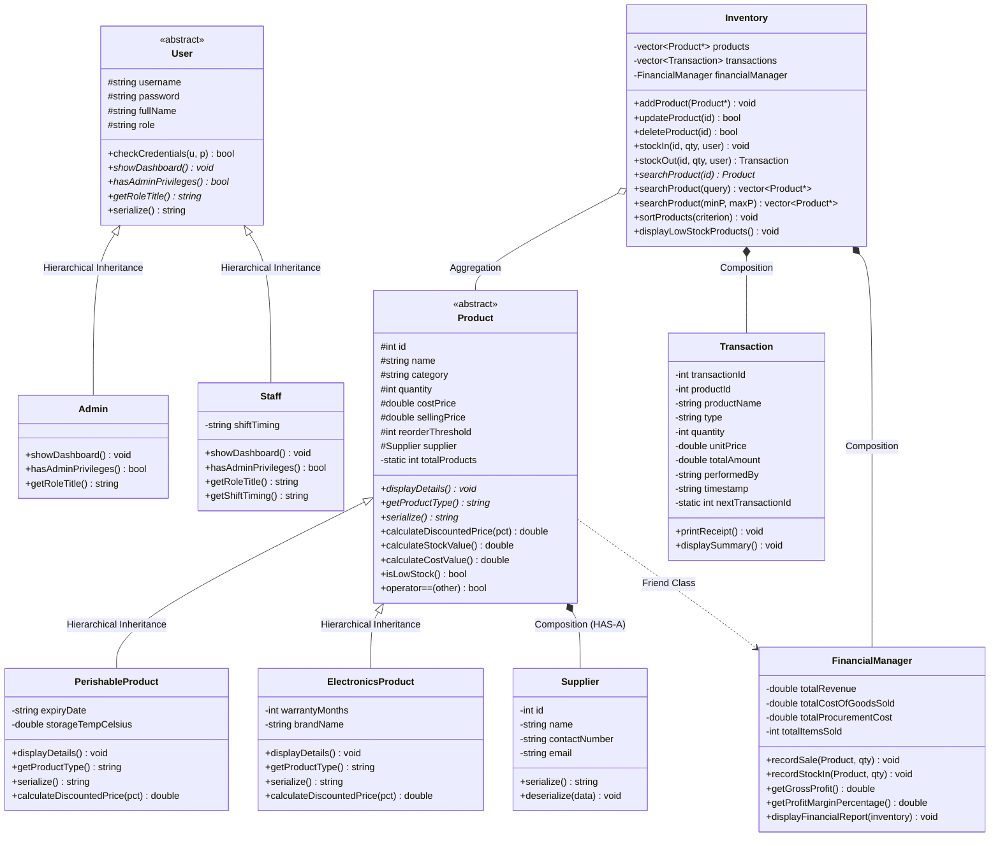
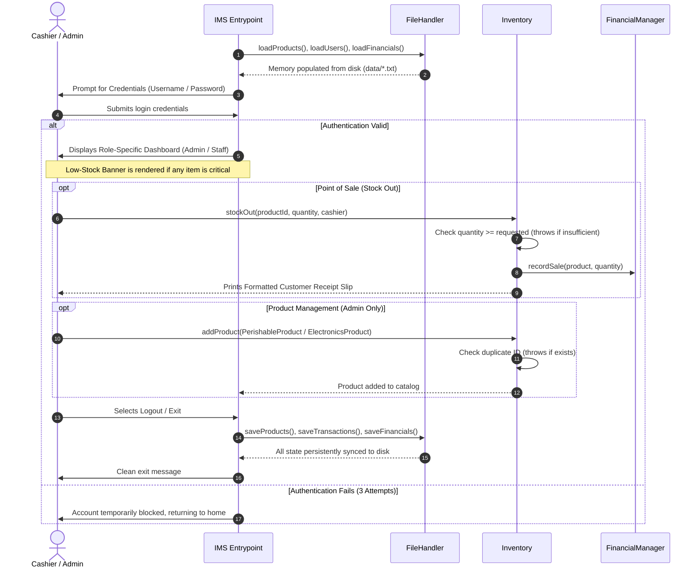

# 📦 Inventory Management System (IMS) — C++ OOP Edition


-darkgreen.svg)


A comprehensive, production-grade console **Inventory Management System (IMS)** developed in **C++** for the **3rd Semester Object-Oriented Programming (OOP)** course.

This project represents a major architectural upgrade from a 1st-semester procedural project (flat arrays and isolated functions) into a fully modular, object-oriented software system demonstrating all standard academic OOP concepts from fundamental classes to advanced runtime polymorphism, templates, custom exceptions, and persistent file handling.

---

## 📑 Table of Contents

- [Project Overview](#-project-overview)
- [Evolution: 1st Semester (PF) vs 3rd Semester (OOP)](#-evolution-1st-semester-pf-vs-3rd-semester-oop)
- [OOP Concepts Implementation Matrix](#-oop-concepts-implementation-matrix)
- [System Architecture & Class Hierarchy](#-system-architecture--class-hierarchy)
- [System Workflow Diagram](#-system-workflow-diagram)
- [Role-Based Access Control (RBAC)](#-role-based-access-control-rbac)
- [Financial Analytics & Billing Engine](#-financial-analytics--billing-engine)
- [Project Directory Structure](#-project-directory-structure)
- [Data Storage Schema](#-data-storage-schema)
- [How to Compile and Run](#-how-to-compile-and-run)
- [Default Login Credentials](#-default-login-credentials)
- [Viva Voce & Interview Preparation Cheat Sheet](#-viva-voce--interview-preparation-cheat-sheet)
- [Authors & Acknowledgments](#-authors--acknowledgments)

---

## 📖 Project Overview

The **Inventory Management System (IMS)** manages store operations, multi-category inventory tracking, supplier communications, cashier point-of-sale billing, financial reporting, and persistent audit logs.

### Key Capabilities:
- **Polymorphic Product Catalog**: Handles distinct product types (`PerishableProduct` for groceries/medicines with expiry dates and temperature controls, and `ElectronicsProduct` with warranty durations and brand tracking).
- **Role-Based Access Control**: Separate interfaces and permissions for **Administrator** (Full Management & Analytics) and **Staff / Cashier** (POS Counter, Stock Movement, Receipt Generation).
- **Point of Sale (POS) & Billing**: Automatic stock deduction, profit/loss recording, and formatted ASCII invoice slip generation upon sale.
- **Financial Intelligence**: Real-time computation of Cost of Goods Sold (COGS), Gross Revenue, Net Profit, Profit Margin percentage, and total warehouse inventory valuation (at cost vs. at retail).
- **Dynamic Low-Stock Warnings**: Real-time alerts displayed whenever stock falls below configurable product reorder thresholds.
- **Robust Exception Handling**: Custom domain exception hierarchy catching invalid quantities, duplicate IDs, missing items, and unauthorized operations.
- **Permanent File Persistence**: Seamless save/load mechanisms using C++ streams (`fstream`) to store data across application restarts.

---

## 🔄 Evolution: 1st Semester (PF) vs 3rd Semester (OOP)

| Feature / Concept | 1st Semester Project (Programming Fundamentals) | 3rd Semester Project (Object-Oriented Programming) |
|---|---|---|
| **Architecture** | Monolithic procedural code in a single file (`Ims.cpp`) | Modular multi-file architecture with clean headers (`include/`) and implementations (`src/`) |
| **Data Storage (Memory)** | Flat parallel arrays (`ids[]`, `names[]`, `quantities[]`) | Dynamic collection of polymorphic objects (`std::vector<Product*>`) |
| **Capacity Limit** | Hardcoded fixed limit (`MAX_PRODUCTS = 100`) | Dynamic heap memory allocation expanding on demand |
| **Product Types** | Generic flat records | Polymorphic hierarchy (`Product` abstract base -> `PerishableProduct`, `ElectronicsProduct`) |
| **User Management** | Single hardcoded admin credentials | Role-Based Access Control with polymorphic `User` hierarchy (`Admin` vs `Staff`) |
| **Error Handling** | Basic if-else console print statements | Standard `try-catch` blocks with custom exception hierarchy (`IMSException`) |
| **Billing / Sales** | Simple integer decrement | Full POS checkout with official formatted customer receipt generation |
| **Financial Tracking** | None | Dedicated `FinancialManager` calculating COGS, revenue, profit margins, and stock valuation |
| **Input Validation** | Manual cin checks | Generic `Utils::getValidatedInput<T>` template function handling stream failures safely |

---

## 🎓 OOP Concepts Implementation Matrix

This project explicitly implements every topic in the standard university **Object-Oriented Programming** syllabus:

| OOP Concept | Project Implementation Details | File References |
|---|---|---|
| **1. Classes & Objects** | Real-world entities encapsulated into distinct classes with state and behavior. | [`Product.h`](include/Product.h), [`User.h`](include/User.h), [`Supplier.h`](include/Supplier.h) |
| **2. Encapsulation & Data Hiding** | Private/protected attributes with public validated getters and setters to enforce business invariants. | All classes in [`include/`](include/) |
| **3. Constructors & Destructors** | Default and parameterized constructors utilizing member initializer lists; destructors managing resources. | [`Product.cpp`](src/Product.cpp), [`User.cpp`](src/User.cpp) |
| **4. Virtual Destructors** | `virtual ~Product()` and `virtual ~User()` ensuring complete deallocation of derived objects through base pointers. | [`Product.h`](include/Product.h), [`User.h`](include/User.h) |
| **5. Static Members** | `Product::totalProducts` counter tracking live catalog count; `Transaction::nextTransactionId` generating unique IDs. | [`Product.h`](include/Product.h), [`Transaction.h`](include/Transaction.h) |
| **6. Inheritance (Single & Hierarchical)** | `User` -> `Admin`, `Staff`; `Product` -> `PerishableProduct`, `ElectronicsProduct`. | [`User.h`](include/User.h), [`Product.h`](include/Product.h) |
| **7. Polymorphism (Runtime)** | Pure virtual methods (`displayDetails()`, `serialize()`, `showDashboard()`) overridden in derived classes. | [`Product.h`](include/Product.h), [`User.h`](include/User.h) |
| **8. Polymorphism (Compile-time)** | Function Overloading (`searchProduct(id)`, `searchProduct(query)`, `searchProduct(minP, maxP)`); Operator Overloading (`operator<<`, `operator==`). | [`Inventory.h`](include/Inventory.h), [`Product.h`](include/Product.h) |
| **9. Abstraction (Abstract Classes)** | `Product` and `User` serve as abstract base classes defining contract interfaces with pure virtual functions (`= 0`). | [`Product.h`](include/Product.h), [`User.h`](include/User.h) |
| **10. Composition** | `Product` HAS-A `Supplier` object embedded within its structure. | [`Product.h`](include/Product.h), [`Supplier.h`](include/Supplier.h) |
| **11. Aggregation** | `Inventory` HAS-A dynamic collection of `Product*` pointers without owning the external class definition. | [`Inventory.h`](include/Inventory.h) |
| **12. Friend Class** | `FinancialManager` declared as friend of `Product` to directly audit purchase costs and selling margins. | [`Product.h`](include/Product.h), [`FinancialManager.h`](include/FinancialManager.h) |
| **13. File Handling (Streams)** | Formatted file I/O via `std::ifstream` and `std::ofstream` with custom serialization / deserialization. | [`FileHandler.h`](include/FileHandler.h), [`FileHandler.cpp`](src/FileHandler.cpp) |
| **14. Exception Handling** | Custom `IMSException` hierarchy (`InsufficientStockException`, `DuplicateProductException`, etc.) with `try-catch` blocks. | [`Exceptions.h`](include/Exceptions.h) |
| **15. Templates** | Template function `Utils::getValidatedInput<T>` providing type-safe numeric range and stream validation. | [`Utils.h`](include/Utils.h) |

---

## 🏛 System Architecture & Class Hierarchy



---

## 🔄 System Workflow Diagram



---

## 🛡 Role-Based Access Control (RBAC)

The system enforces clear security boundaries between management and operational staff:

| Feature / Operation | Administrator (`Admin`) | Staff / Cashier (`Staff`) |
|---|:---:|:---:|
| **Add New Product (Perishable / Electronics)** | ✅ Full Access | ❌ Restricted |
| **Update Existing Product Information** | ✅ Full Access | ❌ Restricted |
| **Delete Product from Catalog** | ✅ Full Access | ❌ Restricted |
| **Perform Stock In (Procurement Restock)** | ✅ Full Access | ✅ Allowed |
| **Perform Stock Out (Point of Sale / Billing)** | ✅ Full Access | ✅ Allowed |
| **Generate Official Customer Receipt Slip** | ✅ Full Access | ✅ Allowed |
| **Search Products (ID / Name / Price Range)** | ✅ Full Access | ✅ Allowed |
| **View Low Stock & Reorder Alert Warnings** | ✅ Full Access | ✅ Allowed |
| **Sort Inventory Catalog** | ✅ Full Access | ❌ Restricted |
| **View Complete Audit Transaction History** | ✅ Full Access | ✅ Recent Shift Only |
| **View Executive Financial Report (Profit/COGS)** | ✅ Full Access | ❌ Restricted |
| **Register New Staff User Accounts** | ✅ Full Access | ❌ Restricted |

---

## 💰 Financial Analytics & Billing Engine

### 1. Executive Financial Report
The system tracks real-time profitability metrics via `FinancialManager`:
- **Gross Revenue**: $\sum (\text{Selling Price} \times \text{Units Sold})$
- **Cost of Goods Sold (COGS)**: $\sum (\text{Purchase Cost} \times \text{Units Sold})$
- **Gross Profit**: $\text{Gross Revenue} - \text{COGS}$
- **Net Profit Margin**: $\left(\frac{\text{Gross Profit}}{\text{Gross Revenue}}\right) \times 100\%$
- **Warehouse Inventory Valuation**:
  - Total Cost Valuation: Capital tied up in current inventory.
  - Total Retail Valuation: Projected revenue upon full inventory liquidation.
  - Projected Potential Profit: $\text{Retail Value} - \text{Cost Value}$.

### 2. Sample Official POS Customer Receipt Slip
```
======================================================
           INVENTORY MANAGEMENT SYSTEM                
                 OFFICIAL RECEIPT                     
======================================================
 Invoice No:     INV-1004
 Date & Time:    2026-11-02 14:30:15
 Cashier/Staff:  staff
 Transaction:    SALE
------------------------------------------------------
 Product ID:     201
 Description:    Dell Wireless Mouse WM126
 Quantity:       2 units
 Unit Price:     $19.99
------------------------------------------------------
 TOTAL AMOUNT:   $39.98
======================================================
          Thank you for your business!                
======================================================
```

---

## 📂 Project Directory Structure

```
Inventory-Management-System/
│
├── include/                          # Header files (Declarations & OOP Interfaces)
│   ├── Exceptions.h                  # Custom exception hierarchy
│   ├── FileHandler.h                 # File persistence controller
│   ├── FinancialManager.h            # Financial analytics & friend class
│   ├── Inventory.h                   # Inventory aggregation manager
│   ├── Product.h                     # Abstract Product base & derived classes
│   ├── Supplier.h                    # Supplier class (Composition)
│   ├── Transaction.h                 # Billing & audit record class
│   ├── User.h                        # Abstract User base, Admin & Staff
│   └── Utils.h                       # Template input validator & UI helpers
│
├── src/                              # Source code (Class Implementations)
│   ├── FileHandler.cpp
│   ├── FinancialManager.cpp
│   ├── Inventory.cpp
│   ├── Product.cpp
│   ├── Supplier.cpp
│   ├── Transaction.cpp
│   ├── User.cpp
│   └── main.cpp                      # Main system driver & menu controller
│
├── single_file/                      # Unified distribution (Dev-C++ / University submission)
│   └── ims_oop_unified.cpp           # Complete project consolidated into 1 file
│
├── InventoryManagementSystem_Complete.cpp # Complete project consolidated into 1 standalone file (Root)
│
├── data/                             # Persistent text files (Auto-generated/updated)
│   ├── products.txt                  # Serialized product records
│   ├── users.txt                     # User accounts (Admin & Staff)
│   ├── transactions.txt              # Complete transaction log
│   ├── financials.txt                # Cumulative financial statistics
│   └── logs.txt                      # Security and activity audit trail
│
├── .gitignore                        # Git ignore rules for build artifacts
├── build.bat                         # 1-Click Windows build & execution script
├── Makefile                          # Cross-platform GNU Makefile
├── LICENSE                           # MIT License
└── README.md                         # Project documentation
```

---

## 💾 Data Storage Schema

All data files use simple, delimited text formats for maximum portability:

- **`data/products.txt`**:
  `TYPE;id;name;category;quantity;costPrice;sellingPrice;reorderThreshold;suppId|suppName|suppPhone|suppEmail;[type-specific fields]`
  - *Perishable extra fields*: `expiryDate;storageTempCelsius`
  - *Electronics extra fields*: `warrantyMonths;brandName`
- **`data/users.txt`**:
  `ROLE;username;password;fullName;[shiftTiming]`
- **`data/transactions.txt`**:
  `transactionId;productId;productName;type;quantity;unitPrice;totalAmount;performedBy;timestamp`
- **`data/financials.txt`**:
  `totalRevenue;totalCostOfGoodsSold;totalProcurementCost;totalItemsSold`
- **`data/logs.txt`**:
  `[YYYY-MM-DD HH:MM:SS] User: username | Action: description`

---

## 💻 How to Compile and Run

### Option 1: 1-Click Windows Batch Script (Recommended)
Double-click `build.bat` in File Explorer, or run in Command Prompt:
```cmd
build.bat
```
*This automatically compiles the modular source code and launches the executable.*

---

### Option 2: Using GCC / MinGW (Command Line)
#### Modular Compilation:
```bash
g++ -std=c++11 -Iinclude src/*.cpp -o inventory_oop.exe
inventory_oop.exe
```

#### Single-File Compilation (Quickest):
```bash
# Using root complete file:
g++ -std=c++11 InventoryManagementSystem_Complete.cpp -o inventory_oop.exe
inventory_oop.exe

# Or using single_file/ distribution:
g++ -std=c++11 single_file/ims_oop_unified.cpp -o inventory_oop.exe
inventory_oop.exe
```

---

### Option 3: Using Dev-C++ 5.11 or Code::Blocks
1. Open **Dev-C++** or **Code::Blocks**.
2. Click **File** ➔ **Open**.
3. Select `InventoryManagementSystem_Complete.cpp` (or `single_file/ims_oop_unified.cpp`).
4. Press **F11** (or click **Execute** ➔ **Compile & Run**).

---

### Option 4: Linux / macOS (Terminal)
```bash
make
./inventory_oop
```

---

## 🔑 Default Login Credentials

The system comes pre-seeded with two accounts for testing:

| Role | Username | Password | Full Name / Title | Permissions |
|---|---|---|---|---|
| **Administrator** | `admin` | `admin123` | Arslan Ali & Muhammad Suleman (Admin) | Full CRUD, User Mgmt, Financial Analytics |
| **Staff Member** | `staff` | `staff123` | Store Cashier Associate | POS Counter, Stock Movement, Search, Alerts |

*(Administrators can register additional staff accounts via menu option 12).*

---

## 🧠 Viva Voce & Interview Preparation Cheat Sheet

When presenting this project to your professor or external examiner, be prepared for these common questions:

### Q1: Why did you declare the destructor in `Product` as `virtual`?
> **Answer**: Because `Product` is an abstract base class, and we manipulate derived objects (`PerishableProduct`, `ElectronicsProduct`) using base class pointers (`Product*`). If the destructor were not `virtual`, deleting a derived object via a `Product*` pointer would invoke only the base class destructor (static binding), leading to resource leaks. A `virtual` destructor ensures the derived class destructor runs first, followed by the base class destructor (dynamic dispatch).

### Q2: What is the difference between Abstraction and Encapsulation in your project?
> **Answer**: 
> - **Encapsulation** is data hiding and bundling data with methods inside classes. For example, in `Product`, `quantity`, `costPrice`, and `sellingPrice` are protected/private, and cannot be set directly without passing through setters that validate that prices and quantities are non-negative.
> - **Abstraction** is hiding implementation complexity and exposing only the essential interface. `Product` and `User` are abstract classes with pure virtual functions (`displayDetails() = 0;`), defining a contractual interface without exposing internal logic.

### Q3: Where did you use Function Overloading vs Function Overriding?
> **Answer**:
> - **Function Overloading (Compile-Time Polymorphism)** is used in `Inventory::searchProduct`:
>   1. `Product* searchProduct(int id)` — searches by exact ID.
>   2. `vector<Product*> searchProduct(string query)` — searches by name/category keyword.
>   3. `vector<Product*> searchProduct(double min, double max)` — filters by price range.
> - **Function Overriding (Runtime Polymorphism)** is used when `PerishableProduct` and `ElectronicsProduct` override the pure virtual `virtual void displayDetails() const override` method defined in the base `Product` class.

### Q4: Explain the difference between Composition and Aggregation in your code.
> **Answer**:
> - **Composition (Strong Ownership / HAS-A)**: `Product` composes `Supplier`. The `Supplier` object is a direct value member of `Product`. If the `Product` is destroyed, its embedded `Supplier` is destroyed with it.
> - **Aggregation (Weak Ownership)**: `Inventory` aggregates `Product*` pointers (`std::vector<Product*>`). The `Inventory` manages pointers to products allocated on the heap, allowing polymorphic references without statically binding product types.

### Q5: Why did you use `friend class FinancialManager;` inside `Product`?
> **Answer**: `FinancialManager` needs to calculate sensitive financial metrics such as Cost of Goods Sold (COGS) and profit margins by auditing the product's `costPrice` and `sellingPrice`. Making `FinancialManager` a friend class allows it direct, controlled access to internal financial variables without exposing them publicly to untrusted external callers.

---

## 👨‍💻 Authors & Acknowledgments

- **Authors**: Arslan Ali & Muhammad Suleman
- **Program**: Bachelor of Science in Software Engineering (BSSE)
- **Course**: Object-Oriented Programming (CS201 / SE201)
- **Semester**: 3rd Semester Project

---

## ⭐ Support & Feedback

If you find this project helpful for your academic studies or semester submission, please consider giving this repository a ⭐ on GitHub!
